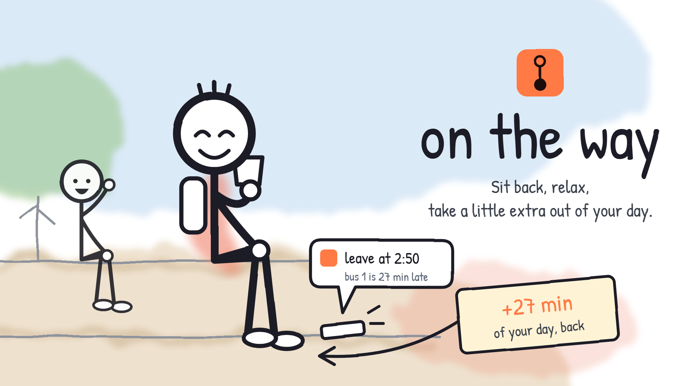

# On the way

**Sit back, relax, take a little extra out of your day.**

On the way tells day scholars when to leave for their UPSRTC bus. Instead of GPS it uses the tickets conductors already cut, and its timetable corrects itself from every trip.



- **Live app:** [basics.smartabeshackathon.tech](https://basics.smartabeshackathon.tech). Install it on Android from the browser menu.
- **Demo video:** `[YouTube link]`
- **Built for:** the Devpost *Build With AI: Basics* hackathon

## The problem

UPSRTC buses have no public live tracking. Riders only have a printed timetable, and it's often off by half an hour. So day scholars, some travelling 80 km a day, leave early, skip time with friends, and wait at the roadside.

Riders don't really need a map. They need to know **when to leave**.

## What it does

- **Next buses for any two stops,** over the next 24 hours, each with a live "be at your stop by" time.
- **Transfers:** up to two changes, with the wait at each change kept live.
- **Notify me, with no sign-up.** You get a push 45, 30 and 15 minutes before you need to leave, plus another every time the bus slips 10 more minutes. Your phone's push subscription is its identity.
- **Line view:** every stop on a route, with live buses and connecting lines.
- **Installs as an app** (a PWA).

## How it works

```
conductor's ticket ──signed──▶ ingest ──▶ trip state ──▶ learned travel times
                                                         │
                rider's phone ◀── push / live updates ◀── predictions + planner
```

1. **Tickets as check-ins.** Each conductor device signs its events with HMAC-SHA256 over `timestamp.body`, using its own key. The API rejects anything signed more than 5 minutes off its clock, drops duplicates by idempotency key, and replays offline batches in the order they happened.
2. **A timetable that learns.** Each road segment's travel time updates as $\hat t_n = (1-\alpha)\hat t_{n-1} + \alpha t_n$, with $\alpha = \max(1/n, 0.2)$.
   - **The first real trip replaces the timetable,** since we already know it's wrong.
   - **Outliers are ignored:** a trip outside 0.33×–3× of the current estimate doesn't count.
   - **Real changes are adopted:** three outliers in a row on the same side become the new normal.
   - **Separate estimates per time of day.**
3. **Prediction and planning.**
   - Each bus gets an expected time at every stop (from what's been learned) and an estimated one (from its latest ticket).
   - The planner searches in rounds (RAPTOR-style) with 0–2 changes, a 5-minute connection buffer, and a 24-hour window that wraps into tomorrow.
4. **Alerts.** They're sent with Web Push (VAPID) and scheduled with Postgres plus in-process timers. The timers re-arm on every ticket and every minute, and reload from the database when the server restarts.

## Stack

| Part | Tech |
|---|---|
| Workspace | Bun workspaces, TypeScript |
| Core logic | `packages/core`: pure TS, tested with `bun test` |
| API | `Bun.serve`, tRPC v11, live updates over SSE, `web-push` |
| Web | Next.js 16 (App Router), Tailwind v4, shadcn/ui, TanStack Query |
| Data | Postgres, Prisma 7 |
| Deploy | API compiled with `bun build --compile` to EC2 (pm2 behind Cloudflare Tunnel); web on Vercel |
| Video | Remotion, with an ElevenLabs voiceover |

## Repo layout

```
apps/api         HTTP + tRPC API, ticket ingest, live hub, alert scheduler
apps/web         Next.js PWA
packages/core    trip matching, prediction, learning, planner, alert rules (no I/O)
packages/db      Prisma schema, migrations, seed, db:rekey
scripts/replay   the demo conductor: signs real ticket events
scripts/deploy   API build-and-deploy script, pm2 config
video            the demo video, as code (Remotion)
devpost          planning docs: scope, PRD, spec, build checklist, script
```

## Run it locally

You'll need [Bun](https://bun.sh) and a Postgres database. The commands below are for PowerShell.

```powershell
bun install

# 1. configure: copy each example and fill it in
Copy-Item packages/db/.env.example packages/db/.env   # DATABASE_URL
Copy-Item apps/api/.env.example apps/api/.env         # DATABASE_URL, WEB_ORIGIN=http://localhost:3000, VAPID keys
Copy-Item apps/web/.env.example apps/web/.env.local   # NEXT_PUBLIC_API_URL=http://localhost:4000, VAPID public key
bunx web-push generate-vapid-keys                     # paste into both .env files

# 2. database: schema, demo network, device keys for the replay script
bun run db:migrate
bun run db:seed

# 3. start the API (:4000) and the web app (:3000)
bun run dev
```

`apps/api/.env` also asks for `REDIS_URL` and `BETTER_AUTH_*`. They're left over from the original plan and aren't used, but any valid URL and any 32-character string will satisfy the config check.

### Play the conductor

```powershell
# a scripted afternoon: one bus runs ~15 min behind its timetable and the app learns it
bun run replay -- --scenario demo --speed 60

# or one ticket at a stop, right now
bun run replay -- --send "Lal Kuan" --bus R1-A
```

Search **Raj Nagar → Mohan Nagar** in the app and watch the times move.

### Tests

```powershell
bun test          # core logic: matching, learning, prediction, planner, alerts
bun run typecheck
```

## The video

The demo video is code. To edit it or render it again:

```powershell
cd video
npm install
npm run studio    # preview at http://localhost:3125
npm run render    # writes out/on-the-way.mp4
```

The voiceover clips are in `video/public/audio/`, generated with ElevenLabs.

## Limits of the demo

- **Stops and routes:** the stop names are real places around Ghaziabad, but the network and timetable are made up.
- **Tickets:** they come from the replay script. A real deployment would connect to UPSRTC's ticket machines.
- **Device keys:** each bus's key is stored as-is in the database, not encrypted. Encrypting it is future scope.

## License

[MIT](LICENSE) © 2026 Kunal Rana
